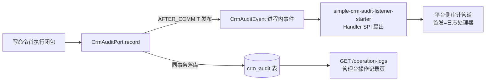

# 审计与幂等

两个横切机制：审计回答"谁在什么时候对什么做了什么"，幂等回答"重试安全吗"。模块总览见根 [README](../../README.md)。

## 审计一源两投影

埋点只有一处：`CrmAuditPort.record()`。同一次调用产生两个投影，一致性契约与消费方不同：

- **库内投影（事实级）**：与业务事实同一事务提交——事实在审计在、重放不重复落；是 `/operation-logs` 查询端点的唯一权威数据源。
- **事件投影（平台级）**：提交**之后**才发——事件丢失/延迟绝不影响业务事务；反之它也不承担与事实严格一致的义务。由审计 listener 家族消费（Handler SPI，首发仅日志处理器），享受独立于业务库的保留与跨系统聚合。
- 事件载荷=审计记录的字段投影（owner/action/targetResourceType/targetResourceId/correlationId/resultCode/occurredAt），不另长语义。回滚不发、幂等重放不重发。

## 幂等语义全表

全部写端点必带 `Idempotency-Key` 头。稳定范围键=`owner|commandType|resourceType[|targetId]|idempotencyKey`：

| 场景 | 行为 |
|---|---|
| 同键同参数重放 | 创建复用首资源 ID 并回读；已知目标命令返回首次成功结果 |
| 同键不同参数 | 409 `IDEMPOTENCY_KEY_REUSED_WITH_DIFFERENT_PAYLOAD` |
| 首次失败 | 不留幂等成功记录，可安全重试 |
| 并发同键首请求 | 原子收敛为同一结果 |

两类端口：

- **创建幂等**（服务端生成 ID：建档/建联系人/录商品/建草稿/重议派生）：首成功同事务保存分配的资源 ID，重放直接返回该 ID 再读回事实。
- **已知目标幂等**（签发/确认/编辑/撤回/停复启/上下架/合并/双转移/履约回写/重置/消费者登记）：按目标资源 ID 作用域，首次成功结果 JSON 与业务事实同事务保存在 `crm_idempotency.first_result_json`；后续迁移后重放仍恢复首响应，包括版本、时间、行项与冻结条款。报价转移的展示态也在首次结果中冻结；没有领域返回值的消费者登记保存 JSON `null`，HTTP 确认体按相同请求参数返回。

报价创建和重议遵守创建幂等：只复用首个报价 ID，HTTP 响应展示回读版本的当前状态。后续签发、确认或取代后重放创建请求，不能把当前事实标成草稿，也不再生成报价、订单、交付项或审计。

创建查重不授予资源访问权。客户或报价已转移归属后，旧创建请求仍按当前归属校验；重议同时校验源报价和派生报价的当前归属，不因旧幂等键返回他人的事实。

重放的关键不变量：**不重复状态迁移、不重复生成订单、不重复写审计、不重复发事件、不修改订单展示态**。当前状态通过查询端点读取。聚合版本乐观校验（`expectedAggregateVersion`）和首次成交的客户状态校验在首执行闭包内——重放时版本或业务状态已前进属正常，不挡重放；当前身份、API 与 DATA 校验始终执行。

## 为什么两个都要

- 只留事件：对象生命周期审计变尽力而为（丢失=有洞），管理台页面要查运维设施=方向反了；"重放不重复审计"无法在事务外表达。
- 只留库表：无跨系统统一审计流、无独立保留策略，运维/合规要查 CRM 得直连业务库。

IAM 自身即此双层形态（库内事实+listener 推平台），CRM 是家族形态的复用。
