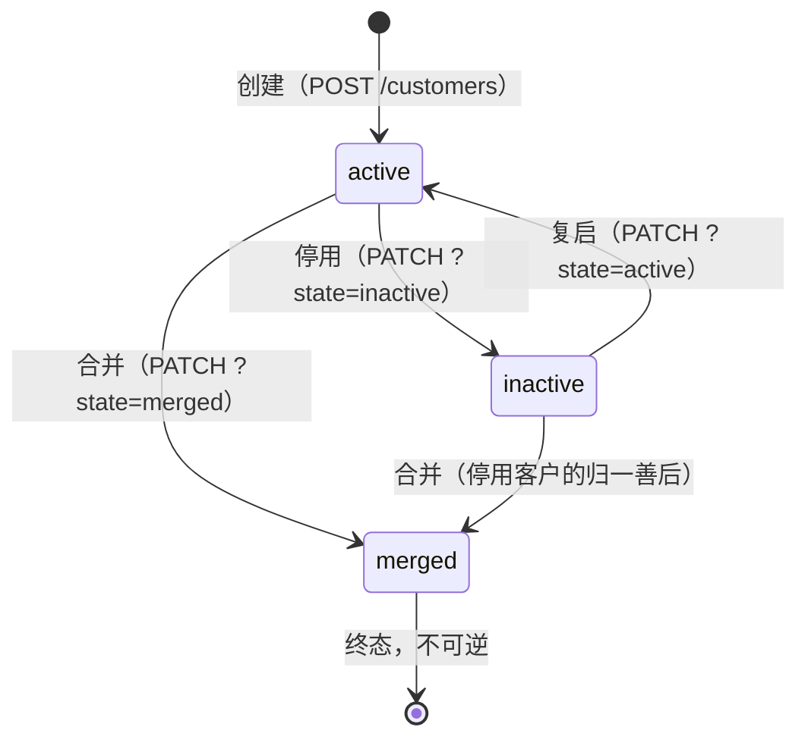

# 客户与联系人

CRM 档案域的第一环：客户是报价、订单与交付的归属主体，联系人挂在客户名下。模块总览与端点索引见根 [README](../../README.md)，身份与数据范围见 [权限与数据范围](权限与数据范围.md)。

## 客户三态

- **active 正常**：唯一可进入报价与成交的状态。创建、编辑草稿与确认成交前都会复检客户未停用——停用客户不产生新成交。
- **inactive 已停用**：可逆冻结。停用不是删除，历史报价与订单全部保留。
- **merged 已合并**：终态。源客户并入目标客户后记录 `mergedIntoCustomerId`，不物理删除。

## 治理四动作

停用/复启/合并/归属转移都是 `PATCH /customers/{id}` 按查询参数分派的动作，各自挂接专属权限码（`crm.customer.disable/activate/merge/transfer`），详见 [权限与数据范围](权限与数据范围.md)。

**合并**（源 → 目标，同事务原子完成）：

- 源客户的联系人、未完结报价与订单全部改挂目标客户；
- 源客户置 `merged` 终态；
- 已确认的历史事实只改客户指向、不改归属（历史不追改）。

**归属转移**（`?owner=iam:目标`）：

- 客户本体与未完结报价同事务改指新归属；
- 已确认订单保持原归属不动——成交事实随当时的销售，交付按它执行；
- 新归属的合法性由认证体系保证（必须是存在的 IAM 人员主体），CRM 不校验在职状态。

合并与转移是治理动作：跨人操作是动作语义本身，准入由专属权限码控制，写路径不做 owner 等值拦截。

## 联系人

联系人 = 客户名下的对接人（姓名+职务），创建时校验目标客户存在且未停用。客户合并时联系人随客户改挂目标。联系人无独立状态机，随客户存亡。

## DATA 维度

客户列表与点查按 `crm-customer` 资源的 owner 维度执行：人员默认只见本人客户，持有 DATA 授权（部门/受限范围）时按授权范围扩展；机器凭据按其授权范围。联系人随客户可见；报价、订单和履约项分别按自身 owner（履约机器回写按派发消费者）执行，客户合并只改客户指向，不追改已确认历史 owner。目录（商品）读不受 owner 限制——见 [目录与商品](目录与商品.md)。
