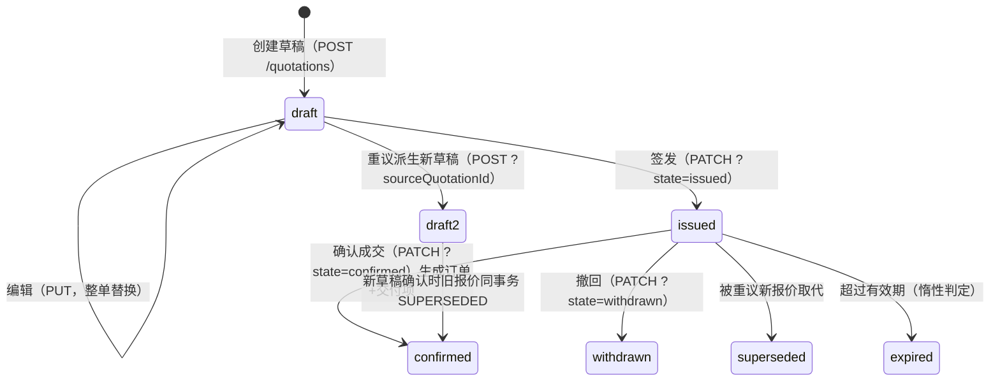
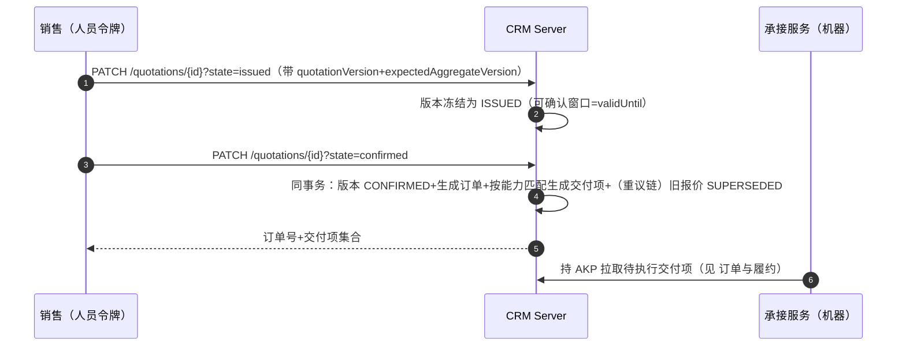

# 报价与成交

CRM 的核心域：从草稿到成交的完整商业承诺链。模块总览见根 [README](../../README.md)，权限与分页契约见各自专篇。

## 展示态六档

撤回/取代/过期都是**终态**：不再提供保存、签发、确认、重议或归属转移入口。终态判定真相在版本行 state（撤回/取代后聚合字段与草稿完全同形，过期由 `validUntil` 惰性派生，服务端按版本事实派生 `state` 字段返回），前端按 `state` 渲染，不得按聚合字段自判。

报价可以可选关联一个商机（`opportunityId`），同一商机允许多个报价，直接报价仍可省略该字段。关联报价确认成交时，报价、订单、履约项和商机 `WON` 在同一事务内提交；商机不能通过人工阶段 PATCH 直接推进为 `WON`。重议报价复制来源报价的商机归属，旧报价与新报价保持同一销售管线。

报价归属转移只适用于未确认且未过期的报价。报价关联未终态商机时，转移事务同步商机 owner，保证新 owner 后续可以确认成交；客户 owner 与已确认历史不追改。需要移动客户及其整条未完结销售管线时，应使用客户或商机归属转移。

## 两个版本号

| 概念 | 谁递增 | 用途 |
|---|---|---|
| `currentVersion` 报价版本 | 重议派生新报价时新起（编辑不变） | 商业条款的版次 |
| `aggregateVersion` 聚合版本 | 每次状态迁移+1 | 乐观锁：签发/确认须带 `expectedAggregateVersion`，预期≠当前即 409 |

编辑草稿（`PUT /quotations/{id}`）= 整单替换：行项、有效期、单价全部以请求为准，报价版本号不变、聚合版本递增。编辑落库同时整版替换版本行——行明细存于版本行，只更新聚合不替换版本行会导致编辑丢失。

## 签发与确认

- 签发后客户才可确认；确认前复检客户未停用。
- 过期是惰性判定：已签发且越过 `validUntil` 即视为过期，不落库、无定时任务——读取侧按当前时间派生。
- 确认是同事务原子动作：任一步失败整体回滚，不产生半截订单。

报价归属转移只适用于未确认且未过期的报价。报价关联未终态商机时，转移事务同步商机 owner，保证新 owner 后续可以确认成交；客户 owner 与已确认历史不追改。已终态商机上的报价不能再转移或确认。一个商机只能由一份关联报价成交，第二份报价确认会被拒绝。需要移动客户及其整条未完结销售管线时，应使用客户或商机归属转移。

## 重议

对已签发报价 `POST /quotations?sourceQuotationId=旧单` 派生新草稿（快照复制+取代链）。**旧报价在那一刻不变**；新草稿确认成交时旧报价才同事务置 `SUPERSEDED`。重议创建走创建幂等：同键重放返回首成果报价。

## 商机关联

报价可可选关联一个商机（创建/重议时携带 `opportunityId`）：同一商机可关联多份报价，重议沿用来源商机；关联校验=同客户+商机未终态。**确认成交时商机在 同一事务 内自动派生为 `won`**——赢单不可人工申报，只能由成交事实派生。商机侧语义详见 [商机与销售管线](商机与销售管线.md)。

## 幂等语义

全部写路径支持幂等键重放（`Idempotency-Key` 头）：同键不同参数返回 409。创建草稿和重议派生复用首成果报价 ID，并按当前权限回读；签发、确认、编辑、撤回恢复首次成功结果，后续变更不覆盖首次响应，**不重复迁移状态、不重复生成订单、不重复写审计**。
