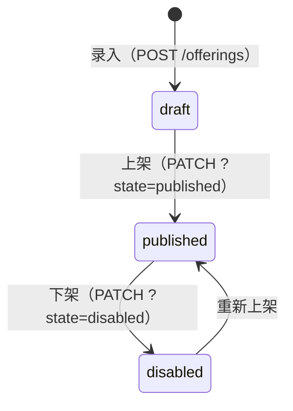

# 目录与商品

CRM 的可售目录：商品（Offering）是报价行项里唯一可引用的目录资产。模块总览见根 [README](../../README.md)。

## 三态

- **draft 录入**：创建后的初始态，尚不可进报价。
- **published 可售**：唯一可被报价引用的状态。
- **disabled 已下架**：不再进入**新**报价；历史报价、行项快照与订单不受影响。下架可逆（重新上架）。

上架/下架按查询参数分派挂专属权限码（`crm.offering.publish` / `crm.offering.disable`）。

## 快照冻结语义

报价创建/编辑时校验商品为 `published`；**确认成交时不复检**——行项的数量、单价与履约义务模板在草稿构造时已冻结为快照，目录后续的上下架、改名都不影响已成立的报价与订单。这保证了"当时承诺什么就交付什么"。

## 承接能力声明

每个商品声明 `requiredConsumerCapability`（承接能力标识，如 `software-license-issue`）：确认成交时按行项的能力声明匹配**已启用**的履约消费者来生成交付项。没有可用承接方时确认被拒绝（409）。消费者登记见 [订单与履约](订单与履约.md)。

## 可见性

目录读对全体持 `crm.offering.read` 码者开放，不受 owner 维度限制——目录是团队共享资产。若未来出现敏感价目场景再评估 DATA 维度（设计 §13 残余风险在档）。
