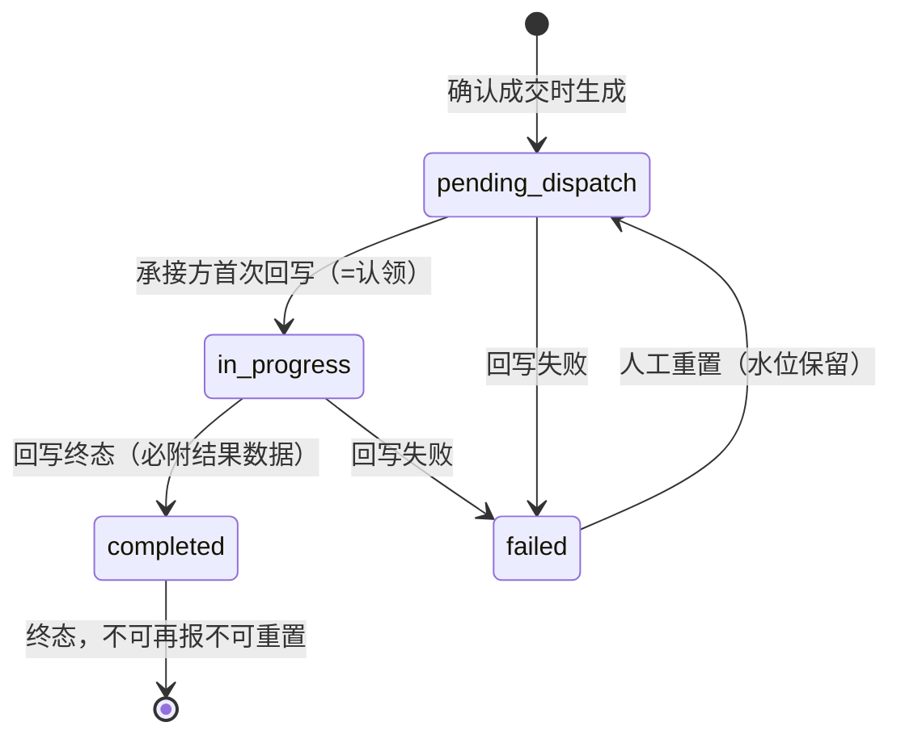
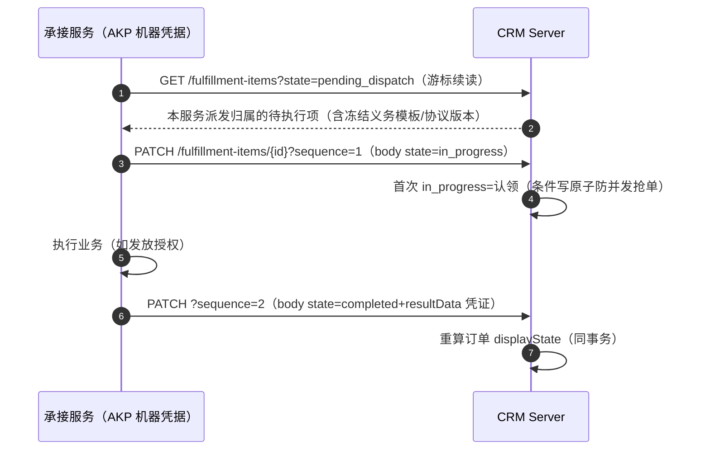

# 订单与履约

成交之后的世界：订单是承诺的兑现凭证，交付项是承接服务的执行单元。模块总览见根 [README](../../README.md)。

## 订单

订单只由报价确认生成（继承报价归属，行项=冻结快照），人不直接创建订单。订单展示态 `displayState` 是**交付事实的派生投影**：

| displayState | 含义 | 派生条件 |
|---|---|---|
| `pending_fulfillment` | 待履约 | 本单交付项无一完成 |
| `partially_fulfilled` | 部分履约 | 部分完成 |
| `fulfilled` | 已履约 | 全部完成 |

派生入口唯一（core `OrderDisplayState.derive`），在**履约回写与人工重置的同一事务内**重算落库（状态未变化不写、不加版本噪声），列表与详情读同一列——两边永远一致。历史偏差用 `docs/migration/` 的核对/修复脚本按明确订单范围处理，不在查询路径自动回填。

## 交付项状态机

## 拉取-认领-回写（消费范式）

- **序号严格递增**：`sequence` 每次回写必须大于当前水位，防乱序、防旧请求覆盖新事实。
- **认领原子**：首次 `in_progress` 用仓储条件写实现——两个服务并发拉到同一项时只有一个认领成功。
- **结果数据必附**：终态回写必须带 `resultData`（如授权编号），交付凭证是客户侧的可见交付物。
- **人工重置**：仅 `failed` 项可重置回待执行（`?state=PENDING_DISPATCH`），序号水位保留（不清零、不重复历史），供承接方重新处理。重置与回写一样同事务重算订单展示态。

## 交付项可见性双轨

人员按 owner 维度（继承报价归属+DATA 授权范围）；机器按**派发归属**（`assignedConsumerId`=自己的 clientId）——承接服务只能拉到派给自己的项。

## 消费者登记

承接服务开工前先登记（`POST /fulfillment-consumers`，consumerId 必须与其 AKP clientId 一致）：声明承接能力标识+协议版本+启停。确认成交时按行项能力匹配**已启用**消费者生成交付项；无可用承接方则确认被拒。登记/启停是管理面动作（专属权限码），同键重放不重复登记。
